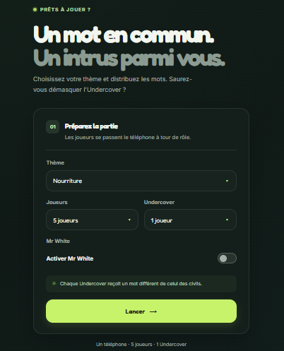

# Undercover Infinite

Jeu de soirée **Undercover** jouable sur un seul téléphone : on se passe l'appareil, chacun découvre son mot en secret, puis le groupe discute, vote et élimine jusqu'à la victoire d'un camp.

**Démo : [https://undercoverinfinite.vercel.app/](https://undercoverinfinite.vercel.app/)**



## Comment on joue

1. Choisis un thème (ou « Tous les thèmes »), le nombre de joueurs et le nombre d'undercover.
2. Chaque joueur découvre son mot à tour de rôle, puis cache l'écran et passe le téléphone au suivant.
3. Les civils ont tous le même mot, les undercover un mot proche. Personne ne sait quel rôle il a : on voit seulement son mot.
4. Chacun donne un indice, puis le groupe vote pour éliminer un joueur.
5. Le rôle du joueur éliminé est révélé, et la partie continue jusqu'à la victoire d'un camp.

### Mr White

À partir de 5 joueurs, on peut activer **Mr White** : il n'a pas de mot et doit faire semblant d'en avoir un. Il gagne s'il n'est pas découvert, ou s'il devine le mot des civils quand il est éliminé.

## Fonctionnalités

- Jeu en pass-and-play sur un seul appareil, sans compte ni serveur
- Plusieurs thèmes de paires de mots, plus un mode « Tous les thèmes »
- Rôle Mr White, avec vérification de sa réponse (insensible aux majuscules et aux accents)
- Phase de discussion avec ordre de passage aléatoire, vote, élimination et conditions de victoire
- Écran de fin avec les mots et les rôles de chaque joueur
- Interface pensée pour mobile, avec un design personnalisé

## Technologies

Next.js · React · TypeScript · Tailwind CSS · déployé sur Vercel

## Lancer le projet en local

```bash
git clone https://github.com/PierreBoudraa/UndercoverInfinite.git
cd UndercoverInfinite
npm install
npm run dev
```

Puis ouvre [http://localhost:3000](http://localhost:3000).

## Structure

```
app/            pages et mise en page Next.js
components/     interface du jeu (écrans, menus)
lib/game.ts     logique du jeu : tirage de la paire, attribution des rôles
data/pairs.json paires de mots par thème
```

## Ajouter des paires de mots

Les paires sont dans `data/pairs.json`, au format `thème → liste de paires [mot civil, mot undercover]` :

```json
{
  "Animaux": [
    ["Dauphin", "Requin"],
    ["Loup", "Chien"]
  ]
}
```

Une bonne paire associe deux mots de la même catégorie, simples et connus de tous, mais qui ne sont pas des variantes l'un de l'autre.

## Idées pour la suite

- Interface en anglais, espagnol et allemand, avec un fichier de paires par langue
- Génération de paires par IA à partir d'un thème libre
- Mémorisation des paires déjà jouées pour éviter les répétitions
